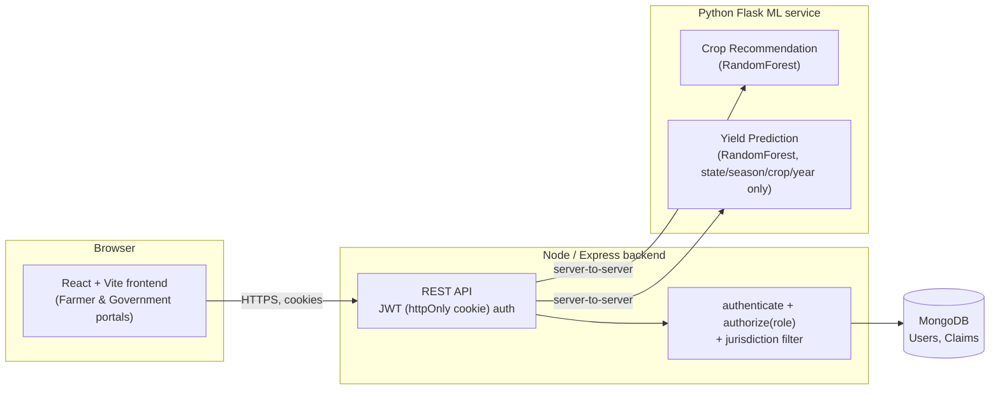

# AI-Powered Geo-Rural Intelligence System

A full-stack system for Forest Rights Act (FRA) claim tracking and farmer decision support, built across 9 phases. **Two roles only: `FARMER` and `GOVERNMENT_OFFICIAL`.** There is no Admin role, Admin UI, Admin API, or Admin database record anywhere in this codebase, and no OTP/SMS/phone-verification code anywhere — authentication is email + password only.

## Contents

- [System overview](#system-overview) — architecture, roles, what each service does
- [Quick start](#quick-start) — install and run all three services
- Phase-by-phase detail (kept below, unchanged, as the implementation record): [Phase 1–2](#whats-implemented-in-this-phase), [3 Crop Recommendation](#phase-3--crop-recommendation-farmer-only), [4 Yield Prediction](#phase-4--yield-prediction-farmer-only), [5 FRA Monitoring](#phase-5--fra-monitoring-farmer-only), [6 Government Dashboard](#phase-6--government-official-dashboard), [7 Claim Management](#phase-7--government-fra-claim-management), [8 GIS Map](#phase-8--government-gis-map)
- [Phase 9 — Final QA, Security Audit, Polish & Deployment Readiness](#phase-9--final-qa-security-audit-polish--deployment-readiness) — **start here for testing, security checklist, deployment, and known limitations**

## System overview



| Layer | Tech | Talks to |
|---|---|---|
| Frontend | React 18, Vite, React Router, Tailwind, Leaflet/React-Leaflet | Backend only (never the ML service or MongoDB directly) |
| Backend | Node/Express, Mongoose, JWT (httpOnly cookie), bcrypt | MongoDB, Flask ML service |
| ML service | Python/Flask, scikit-learn, joblib | Nothing (stateless, called only by the backend) |
| Database | MongoDB | — |

**Roles and what they can reach**

| | FARMER | GOVERNMENT_OFFICIAL |
|---|---|---|
| Crop Recommendation, Yield Prediction | ✅ own use | ❌ |
| FRA Monitoring (own claim, by reference ID) | ✅ own claim only | ❌ |
| Government Dashboard, Claim Management, GIS Map | ❌ | ✅ inside assigned jurisdiction only |

Every restriction above is enforced **server-side** (`authenticate` → `authorize(role)` → jurisdiction/ownership filter on every request); the frontend's route guards are a UX convenience only, never the security boundary.

## Quick start

```bash
# 1. ML service (Python 3.11+)
cd ml-service && cp .env.example .env
python -m venv venv && source venv/bin/activate
pip install -r requirements.txt && python app.py            # :5001 — needs models/ (see "ML service" below)

# 2. Backend (MongoDB running locally, or a connection string in .env)
cd backend && cp .env.example .env
npm install && npm run dev                                   # :5000

# 3. Frontend
cd frontend && cp .env.example .env
npm install && npm run dev                                    # :5173
```
Then register a Farmer and a Government Official account at `http://localhost:5173/register`, or seed demo data — see [Phase 9 → Seed / demo data](#seed--demo-data) below.

## What's implemented in this phase

- React + Vite frontend, Node/Express backend, MongoDB (Mongoose), and a
  Flask ML service placeholder — three independently runnable services.
- Email/password registration and login for exactly two roles.
- Password hashing with bcrypt (12 salt rounds).
- JWT auth delivered via an httpOnly cookie (not localStorage).
- Backend `authenticate` + `authorize(role)` middleware enforced on every
  protected route — the real security boundary.
- Role-based redirection after login (`/farmer/dashboard` or
  `/government/dashboard`).
- Frontend `ProtectedRoute` for UX-level route hiding (not the security
  boundary by itself).
- Empty Farmer Dashboard and Government Dashboard shells with role-based
  sidebars.
- Logout, centralized error handling, input validation, CORS.

Not implemented yet (future phases): crop recommendation, yield
prediction, FRA monitoring, government claim management, GIS maps,
analytics/reports of any kind, Admin (never implemented, any phase).

## Project structure

```
project-root/
├── frontend/     React + Vite + Tailwind (port 5173)
├── backend/      Node + Express + Mongoose (port 5000)
└── ml-service/   Python + Flask (port 5001)
```

## Prerequisites

- Node.js 18+ and npm
- Python 3.10+
- A running MongoDB instance (local install or a free MongoDB Atlas cluster)

## 1. Backend setup

```bash
cd backend
cp .env.example .env     # then edit MONGO_URI / JWT_SECRET as needed
npm install
npm run dev               # nodemon, http://localhost:5000
# or: npm start
```

Required environment variables (`backend/.env`):

| Variable | Description |
|---|---|
| `PORT` | Backend port (default `5000`) |
| `NODE_ENV` | `development` or `production` |
| `MONGO_URI` | MongoDB connection string |
| `JWT_SECRET` | Long random secret used to sign JWTs |
| `JWT_EXPIRES_IN` | Token lifetime, e.g. `7d` |
| `CORS_ORIGIN` | Comma-separated allowed frontend origin(s) |
| `ML_SERVICE_URL` | Flask service base URL. Use `http://127.0.0.1:5001` (not `localhost`): on Windows/Node 18+ `localhost` can resolve to IPv6 while Flask listens on IPv4 |
| `ML_SERVICE_TIMEOUT_MS` | Max wait for Flask before returning 504 (default `8000`) |
| `ML_SERVICE_API_KEY` | Optional shared secret sent as `X-Internal-Api-Key`; must match `ml-service/.env` |

## 2. Frontend setup

```bash
cd frontend
cp .env.example .env
npm install
npm run dev                # http://localhost:5173
```

Required environment variables (`frontend/.env`):

| Variable | Description |
|---|---|
| `VITE_API_BASE_URL` | Backend API base URL, e.g. `http://localhost:5000/api` |

## 3. ML service setup (Flask; serves Crop Recommendation)

```bash
cd ml-service
cp .env.example .env
python -m venv venv
source venv/bin/activate   # Windows: venv\Scripts\activate
pip install -r requirements.txt
python app.py               # http://localhost:5001
```

Required environment variables (`ml-service/.env`):

| Variable | Description |
|---|---|
| `ML_SERVICE_PORT` | Flask port (default `5001`) |
| `FLASK_DEBUG` | `true`/`false` |
| `CORS_ORIGIN` | Origin allowed to call this service (the backend) |

## Manual test steps

1. Start MongoDB, then start `backend`, `frontend`, and (optionally) `ml-service`.
2. Visit `http://localhost:5173/register`.
3. Register as a **Farmer** (role = Farmer) → you should land on
   `/farmer/dashboard` showing only the Farmer sidebar.
4. Log out, then register a second account as a **Government Official**
   (role = Government Official) → you should land on
   `/government/dashboard` showing only the Government sidebar.
5. While logged in as the Farmer, manually navigate the browser to
   `/government/dashboard` → you should be redirected to `/unauthorized`.
6. While logged in as the Farmer, call the government API directly to
   confirm server-side enforcement (not just frontend hiding):
   ```bash
   curl -i http://localhost:5000/api/government/dashboard \
     -H "Cookie: token=<paste the farmer's token cookie value>"
   ```
   Expect **403 Forbidden**. Calling `/api/farmer/dashboard` with the same
   cookie should return **200 OK**.
7. Refresh the page while logged in — the session should persist (backend
   re-validates the JWT cookie via `GET /api/auth/me`).
8. Click **Logout** → you should be redirected to `/login`, and the
   dashboard routes should now redirect to `/login` as well.

## API summary (Phase 1)

| Method | Route | Access |
|---|---|---|
| POST | `/api/auth/register` | Public |
| POST | `/api/auth/login` | Public |
| POST | `/api/auth/logout` | Authenticated |
| GET | `/api/auth/me` | Authenticated |
| GET | `/api/farmer/dashboard` | FARMER only |
| GET | `/api/government/dashboard` | GOVERNMENT_OFFICIAL only |
| GET | `/api/health` | Public |
| GET | `/health` (Flask, port 5001) | Public |

## Roles

Exactly two roles exist in this system and its database schema:

- `FARMER`
- `GOVERNMENT_OFFICIAL`

No Admin role, Admin routes, Admin models, or Admin UI exist, and none
will be added in any future phase.


## Phase 2 — Dashboard UI & shared components

- Shared UI: app layout (sticky sidebar + mobile drawer), header, user menu, logout confirmation modal, `PageHeader`, `StatCard`, `EmptyState`, `ErrorState`, `Loading`, `Badge`.
- Farmer Dashboard: welcome banner, 3 feature cards, empty-state cards. Government Dashboard: welcome banner, claim summary placeholders, recent-activity / map / insights placeholders, all labelled "No data connected". No fake analytics or official data.
- Profile pages (both roles): name, email, role, member-since. Only `fullName` is editable via `PATCH /api/auth/me` (authenticated; email, role and password are never editable or returned).
- Unauthorized page now offers "Go to my dashboard".
- Navigation is defined once in `frontend/src/config/navigation.js`.

New endpoint: `PATCH /api/auth/me` (authenticated) — body `{ "fullName": "..." }`.

## Phase 3 — Crop Recommendation (Farmer only)

**Flow:** React form → `POST /api/farmer/crop-recommendation` (Express: `authenticate` → `authorize('FARMER')` → strict validation) → Flask `POST /crop-recommendation/predict` → trained model → top-3 crop names → React result cards.

### The model
No pre-trained model was supplied, so one is trained from `district_agriculture_ml_ready.csv` with `ml-service/training/train_crop_recommendation.py`. The trained artifact (`ml-service/models/crop_recommendation/model.joblib` + `metadata.json`) is included, so the service works without retraining.

- **What it means:** a RandomForest that learns which crops are *commonly grown* under given soil (N, P, K, pH), climate (yearly temperature, rainfall, humidity) and season. It is not a yield, profit or agronomic-suitability model.
- **Data cleaning:** aggregate/catch-all labels (e.g. "Total foodgrain", "Other Vegetables") removed, duplicate names merged (Paddy→Rice, Kapas→Cotton…), crops with under 1,000 rows dropped, leaving **47 crops**.
- **Evaluation (whole districts held out):** precision@3 = 0.79 vs 0.65 for a "most common crops of the season" baseline; at least one of the 3 suggestions is genuinely grown there in 99% of cases. That is a real but modest improvement over the baseline. Scores are never shown in the UI.
- **Limits:** the dataset records units for none of N/P/K, and its soil values are district-level, so treat results as guidance. Values outside the range the model saw (e.g. N above 150) trigger a caution notice in the UI. Users should confirm with a local agriculture office.
- **Retrain:** copy the CSV to `ml-service/data/`, then `pip install -r requirements-training.txt && python training/train_crop_recommendation.py`. Do this if your Python/scikit-learn versions differ from `requirements.txt` (the service refuses a version-mismatched artifact and `/crop-recommendation/ready` returns 503). Only load artifacts you trained yourself (joblib uses pickle).

### API
| Method | Route | Access | Purpose |
|---|---|---|---|
| POST | `/api/farmer/crop-recommendation` | FARMER only (401 anon, 403 government) | Validate input, call Flask, return crops |
| POST | `/crop-recommendation/predict` | Backend → Flask only | Model inference |
| GET | `/crop-recommendation/ready` | Flask | 200 when model loaded, else 503 |

Request fields (all required, no extras allowed): `nitrogen, phosphorus, potassium, ph, temperature, rainfall, humidity` (numbers within the ranges in `ml-service/crop_recommendation/schema.json`) and `season` (`Kharif | Rabi | Summer | Whole Year | Winter | Autumn`).

Success: `{ "success": true, "message": "...", "data": { "recommendations": [{ "rank": 1, "crop": "Wheat", "slug": "wheat" }], "notice": null } }`
Errors: `{ "success": false, "message": "...", "code"?: "...", "errors"?: [{ "field", "message" }] }` with `400` invalid input, `401/403` access, `503` ML unavailable, `504` ML timeout, `502` bad ML response.

### Crop images
`frontend/public/crops/<slug>.svg` are original stylised illustrations (not photographs) generated by `python scripts/generate_crop_illustrations.py` from the model's crop list. A crop with no matching file shows `fallback.svg`. To use real photos, replace a file of the same name.

### Tests
```bash
cd ml-service && python -m unittest discover -s tests -v        # Flask + real model
cd backend && npm test                                         # validator, ML client, access rules
cd backend && RUN_FLASK_INTEGRATION=1 npm test                 # + real Flask/model end to end
node scripts/check-schema-sync.mjs                              # Flask/backend/frontend contract match
```

## Phase 4 — Yield Prediction (Farmer only)

**Flow:** React form → `GET /api/farmer/yield-prediction/options` (choices) and `POST /api/farmer/yield-prediction` (Express: `authenticate` → `authorize('FARMER')` → strict validation) → Flask `/yield-prediction/predict` → Random Forest → predicted value → React result card.

### The model
No yield model was supplied, so it is trained from `district_agriculture_ml_ready.csv` with `ml-service/training/train_yield_prediction.py`. The artifacts (`ml-service/models/yield_prediction/model.joblib` ~50 MB + `metadata.json`) are included.

- **Model:** `RandomForestRegressor(n_estimators=150, max_depth=16, random_state=42)`.
- **Features (only these four):** `state, season, crop, year`. **`area` and `production` are never used and never even loaded** (the script reads only `state, season, crop, year, yield`), because `yield = production / area` in every row and either would leak the answer. The API rejects them as unknown fields; tests enforce all of this.
- **Encoding:** categories are stored as ordered lists in `metadata.json` (the encoders), shared by training and inference; no pandas at runtime.
- **Data preparation:** aggregate rows ("Total foodgrain", "Oilseeds total", "Pulses total") removed; rows with yield 0 removed (production recorded as 0 = unreported); only state/season/crop combinations with at least 5 rows are offered (1,763 combinations, 103 crops, 30 states). The form dropdowns cascade State → Season → Crop from the model's own metadata, so unsupported combinations cannot be chosen; the API rejects them too (400, field `crop`).
- **Year:** the model saw 1997–2020. The API accepts 1997–2030. For years after 2020 a Random Forest cannot project trends, so the UI says so.
- **Metrics (computed by the training script, stored in `metadata.json`, not shown in the UI):**

| Split | R² | MAE | RMSE |
|---|---|---|---|
| Random 80/20 | 0.777 | 1,387 | 28,698 |
| Train up to 2016, test 2017–2020 | 0.843 | 2,495 | 38,974 |

  Earlier figures (R² ≈ 0.832, MAE ≈ 2,572, RMSE ≈ 40,868) were **not reproduced exactly** by this pipeline and are not used anywhere.

### IMPORTANT data caveat: the unit and a scale change around 2015
- The dataset does **not state a unit** for yield, and its scale differs by crop (e.g. coconut is thousands of times larger than wheat). **The UI therefore shows no unit.**
- The `yield` column also **changes scale around 2015**: for 48 of 52 major crops the typical value from 2015 onward is more than 20× higher than in 2010–2014 (overall median 1.26 up to 2014 vs 120 from 2015). Most likely the source mixes measurement units across years. The model learns this, so **predictions for years before and from 2015 are not comparable** (e.g. Punjab / Rabi / Wheat: about 9 for 2010 vs 465 for 2015). The UI shows this in an "About this number" note and marks 2015 on a small year timeline. The R² above is largely driven by this year effect and must not be read as agronomic accuracy.
- No rescaling was applied because that would be an assumption about your data. If you confirm the units, the fix belongs in `load_and_clean()` in the training script, followed by retraining.
- With only four features, a prediction is effectively the model's average over all districts of that state for that crop, season and year.

### API
| Method | Route | Access | Purpose |
|---|---|---|---|
| GET | `/api/farmer/yield-prediction/options` | FARMER only | State/season/crop/year choices from the model metadata |
| POST | `/api/farmer/yield-prediction` | FARMER only (401 anon, 403 government) | Validate, call Flask, return prediction |
| GET | `/yield-prediction/ready`, `/yield-prediction/options` | Flask | Readiness, choices |
| POST | `/yield-prediction/predict` | Backend → Flask only | Model inference |

Request: `{ "state": "Punjab", "season": "Rabi", "crop": "Wheat", "year": 2015 }` (exactly these four fields).
Success: `{ "success": true, "message": "...", "data": { "prediction": { "value": 465 }, "inputs": { "state", "season", "crop", "year", "cropLabel", "cropSlug" }, "notice": null, "dataNote": "..." } }`
Errors use the same shape as Phase 3: `400` invalid input or unsupported combination (with `errors: [{ field, message }]`), `401/403` access, `503` ML/model unavailable, `504` timeout, `502` bad ML response. Missing or incompatible model files make Flask return 503 `MODEL_UNAVAILABLE`; no number is ever invented.

### Retrain
Copy the CSV to `ml-service/data/`, then `pip install -r requirements-training.txt && python training/train_yield_prediction.py` (about 2 minutes). Retrain if your Python/scikit-learn versions differ from `requirements.txt`; a version-mismatched artifact is refused. Only load artifacts you trained yourself (joblib uses pickle).

## Phase 5 — FRA Monitoring (Farmer only)

A farmer sees **nothing** until they enter a claim reference ID that was handed to them in person by the Gram Sarpanch or the authorized registration desk, and even then only a claim that belongs to their own account.

### Flow
1. The page shows only a privacy notice and an ID form. No claims are listed anywhere.
2. `POST /api/farmer/fra/verify {claimId}`: the ID format is validated (non-strings are rejected before any query), then the server looks up `{ claimId, farmer: <logged-in user> }`. The owner always comes from the session, never from the request.
3. Not found and "belongs to someone else" return the **identical 404**, so a guessed ID leaks nothing. Wrong attempts are rate limited per farmer (429 after 8 in 15 minutes; successful lookups never reset the counter).
4. On success the server returns a **10-minute signed grant** bound to that farmer and that claim (HMAC key derived from `JWT_SECRET`, so a login token is never a grant).
5. `POST /api/farmer/fra/claim {grant}`: the grant is checked, then ownership is **re-checked in the database**, and the claim is returned through a field-by-field whitelist (no farmer id, no `_id`, no `changedBy`, no internal notes). Responses are `Cache-Control: no-store`.
6. The page keeps the claim only in memory: "Look up a different claim", navigating away or reloading clears it.

### API (the only two FRA endpoints; no list, search or all-claims route exists)
| Method | Route | Access | Responses |
|---|---|---|---|
| POST | `/api/farmer/fra/verify` | FARMER only | 200 grant, 400 bad ID/body, 401 anonymous, 403 government, 404 not found (or not yours), 429 too many attempts |
| POST | `/api/farmer/fra/claim` | FARMER only | 200 claim, 400, 401, 403 (government, or invalid/expired grant), 404 |

### Claim model (`backend/src/models/Claim.js`)
`claimId` (unique, `FRA-MP-2025-A7K2QX`), `farmer` (ref User, required), `applicant {fullName, village}`, `claimType` (IFR/CR/CFR), `location {state, district, tehsil, village, gramPanchayat, claimedAreaHectares}`, `jurisdiction {gramSabha, subDivisionalCommittee, districtCommittee}`, `geometry` (GeoJSON Polygon/MultiPolygon, 2dsphere index, optional), `status` (APPLICATION_RECEIVED, PENDING, UNDER_REVIEW, FORWARDED, APPROVED, REJECTED), `rejectionReason` (required only when REJECTED), `statusHistory[] {status, changedAt, publicNote, changedBy}`, `submittedAt`, timestamps, and `dataSource` (`DEMO`/`OFFICIAL`, **required, no default**). Cross-field rules (status equals the latest history entry, history chronological, rejection reason only when rejected) are enforced on save. Claims are created by the authorized registration process; there is no farmer-facing way to create or edit one, and the government workflow is a later phase.

### Demo / illustrative data (development only, never official)
Every seeded claim has `dataSource: 'DEMO'`, invented names and made-up boundaries, and the UI shows a **"Demo / Illustrative Data"** label and a note that it is not an official record. Seeding refuses to run when `NODE_ENV=production`.
```bash
cd backend
npm run seed:demo-fra                                      # 2 demo farmers + 6 demo claims
npm run seed:demo-fra -- --farmer-email=you@example.com    # give the first set (4 claims) to YOUR farmer account
npm run seed:demo-fra -- --remove                          # delete all DEMO claims + demo users (@demo.invalid)
```
Removal only touches `dataSource: 'DEMO'` claims and users whose email ends in `@demo.invalid`; real claims and users are never affected. Demo logins use the password printed by the seed (default `DemoFarmer#2025`, override with `DEMO_SEED_PASSWORD`).

| Claim ID | Owner | Status | Boundary |
|---|---|---|---|
| FRA-MP-2025-DEMO01 | Farmer One (or `--farmer-email`) | Under review | Polygon |
| FRA-MP-2024-DEMO02 | Farmer One | Approved | MultiPolygon |
| FRA-MP-2024-DEMO03 | Farmer One | Rejected (with reason) | Polygon |
| FRA-MP-2025-DEMO06 | Farmer One | Application received | none (map empty state) |
| FRA-OD-2025-DEMO04 | Farmer Two | Pending | Polygon |
| FRA-CG-2025-DEMO05 | Farmer Two | Forwarded | Polygon |

### Map
React-Leaflet draws only the one authorized claim boundary (no markers, no other layers). OpenStreetMap tiles need internet; if they fail, a note appears and the boundary is still shown. Leaflet is loaded lazily in its own chunk; if that download fails the page offers "Reload page" (you re-enter the ID, since claims are never persisted). Run `npm install` in `frontend/` to fetch `leaflet` and `react-leaflet`.

### Configuration (`backend/.env`)
`FRA_GRANT_TTL_SECONDS` (600), `FRA_VERIFY_MAX_FAILURES` (8), `FRA_VERIFY_WINDOW_MINUTES` (15).

### Known limits
- The failed-attempt limiter is in memory (per server process). With several server instances use a shared store such as Redis.
- Boundary validation checks structure and coordinate ranges, not self-intersection.
- The `notes` shown in the timeline are the claim history's `publicNote` only. Never put internal officer remarks in it.

### Tests
```bash
cd backend && npm test                        # includes the FRA privacy and access tests
node scripts/check-schema-sync.mjs            # claim-ID format, statuses and GeoJSON rules match backend and frontend
```

## Phase 6 — Government Official Dashboard

A separate dashboard for `GOVERNMENT_OFFICIAL` users. There are still only two roles (FARMER, GOVERNMENT_OFFICIAL) and no admin role or admin screen. Reports, Data Explorer, Historical Analysis and Processing Analysis are **not** separate pages: relevant monitoring information is integrated into this one dashboard.

### Jurisdiction: what an official may see
`User.jurisdiction.areas` is a list of areas, each `{ state, district?, tehsil? }`:

| Area | Grants |
|---|---|
| `{ state }` | every claim in the state |
| `{ state, district }` | every claim in the district |
| `{ state, district, tehsil }` | every claim in the tehsil |

- **Deny by default.** No jurisdiction, an empty list or a malformed area grants **nothing**. The dashboard then returns a normal 200 with an explicit "no area assigned" state, and the database is not queried. A tehsil without a district is invalid. Values must be plain strings (operator objects are dropped) and are matched **exactly** (`Madhya Pradesh`, not `madhya pradesh`); a spelling mismatch fails safe to "no claims".
- **Server-side only.** The scope filter is built from the *logged-in official's stored record* and is the first stage of every database query. The endpoint reads no query string, params or body, so a caller cannot widen their own scope. Registration and profile updates cannot set a jurisdiction.
- **Extensible.** All of this lives in `backend/src/utils/jurisdiction.js`. New levels (block, village) or future roles change that file, not the callers.
- **Self-registration note.** The Phase 1 sign-up form lets anyone choose the "Government Official" role. Such an account has no jurisdiction, so it sees no claims until an operator assigns an area.

### Assigning an area (operator script; there is no admin UI)
```bash
cd backend
npm run assign-jurisdiction -- --email=official@example.com --state="Madhya Pradesh"
npm run assign-jurisdiction -- --email=official@example.com --state="Madhya Pradesh" --district=Balaghat
npm run assign-jurisdiction -- --email=official@example.com --state="Odisha" --add     # add a second area
npm run assign-jurisdiction -- --email=official@example.com --clear                    # remove all areas
```

### API
| Method | Route | Access |
|---|---|---|
| GET | `/api/government/dashboard/summary` | GOVERNMENT_OFFICIAL only (401 anonymous, 403 farmer). No query parameters are read. `Cache-Control: no-store`. |
| GET | `/api/government/dashboard` | (Phase 1 shell, unchanged) |

Response `data`: `scope` (assigned, areas), `views[]` (one per data source), `defaultSource`, `insights`. Each view has `totals` (total, pending, underReview, approved, rejected, requiringAction, byStatus), `districts[]`, `oldestOpenClaimDays`, `boundaries` (counts only; no geometry is sent), and `recentActivity[]` (claim ID, status, date, public note, district, village; no applicant names, owners or history authors).

**Definitions.** *Requiring action* = status `APPLICATION_RECEIVED`, `PENDING` or `UNDER_REVIEW`. *Pending* = status `PENDING` only. Rejected counts are shown for claims in the official's own area; rejection reasons are not shown on the dashboard.

### What is real, demo, reference or empty
| Section | Source and label |
|---|---|
| Summary cards, status chart, recent activity, district workload, map-preview counts | Computed from `Claim` records in the official's area. Claims with `dataSource: OFFICIAL` are labelled **Connected data**; `DEMO` claims are labelled **Demo / Illustrative Data**. The two are **never mixed**: if both exist there is a toggle and separate numbers. Today only demo claims exist. |
| Operational agriculture insights | **Reference dataset**: historical shares of recorded crop area (2015-2019) from the supplied district agriculture dataset, only for the official's own states. Not live data and not FRA claim data. Rebuild with `python scripts/build_agriculture_insights.py --data path/to/district_agriculture_ml_ready.csv` (needs pandas). Only percentages are shown because the dataset states no area unit. If the file is missing the section says "not available". |
| Map overview | Placeholder for the future GIS map (decorative picture + counts). |
| No area / no claims | Explicit empty states with no invented numbers. |

### Demo officials and claims (development only)
`npm run seed:demo-fra` (see Phase 5) now also creates 10 demo claims and 5 demo officials (password printed, default `DemoFarmer#2025`):

| Demo official | Area | Should see |
|---|---|---|
| demo.official.mp@demo.invalid | Madhya Pradesh | 8 claims (Balaghat + Mandla) |
| demo.official.balaghat@demo.invalid | Madhya Pradesh › Balaghat | 5 claims |
| demo.official.od@demo.invalid | Odisha | 1 claim |
| demo.official.assam@demo.invalid | Assam | area assigned, no claims (empty state) |
| demo.official.none@demo.invalid | none | "No area assigned" state |

Give **your own** government account an area with `npm run seed:demo-fra -- --official-email=you@example.com` (default area Madhya Pradesh; `--official-state=` / `--official-district=` to change). `npm run seed:demo-fra -- --remove [--official-email=you@example.com]` removes the demo data and clears that area.

### Charts
The status chart is an accessible SVG donut with a text legend (no charting dependency to install); the district workload and crop shares are simple bars.

### Tests
```bash
cd backend && npm test                 # jurisdiction, dashboard aggregation, authorization, pipeline safety
node scripts/check-schema-sync.mjs     # also checks /farmer/* vs /government/* route separation
```

## Phase 7 — Government FRA Claim Management

A jurisdiction-scoped claim table and an explicit workflow for `GOVERNMENT_OFFICIAL` users. Farmer privacy (Phase 5) is unchanged: farmers still see only their own claim, and workflow remarks are never sent to them.

### Workflow: the only way a status can change
Clients send an **action name**, never a status. The server looks up the new status from the claim's current status and the action:

| Action | From | To | Reason |
|---|---|---|---|
| `ACCEPT_FOR_PROCESSING` | APPLICATION_RECEIVED | PENDING | optional remarks |
| `START_REVIEW` | PENDING | UNDER_REVIEW | optional remarks |
| `FORWARD` | UNDER_REVIEW | FORWARDED | optional remarks |
| `RETURN_FOR_REVIEW` | FORWARDED | UNDER_REVIEW | optional remarks |
| `APPROVE` | UNDER_REVIEW, FORWARDED | APPROVED | optional remarks |
| `REJECT` | UNDER_REVIEW, FORWARDED | REJECTED | **reason required** |

`APPROVED` and `REJECTED` are terminal: no action is available from them. Every other (status, action) pair — 28 combinations — is refused with `409 CLAIM_INVALID_TRANSITION`. The table is `backend/src/utils/claimWorkflow.js`.

### Atomic update
A claim's status and its audit entry change in **one** MongoDB write:
```js
Claim.findOneAndUpdate(
  { $and: [<jurisdiction filter>, { claimId }, { status: expectedStatus }] },
  { $set: { status, rejectionReason }, $push: { statusHistory: entry } }
)
```
The client also sends `expectedStatus` (the status it saw); the filter compares it against the real current status, so two officials acting at once cannot both win, and acting on a stale screen is refused with `409 CLAIM_STATE_CHANGED` showing the real current status. This project does not use MongoDB multi-document transactions (they need a replica set, and a standalone `mongod` is the common local setup); a single-document update is sufficient here since status and history change together.

### API (all under the existing `authenticate` + `authorize('GOVERNMENT_OFFICIAL')` guard, then jurisdiction)
| Method | Route | Notes |
|---|---|---|
| GET | `/api/government/claims` | paginated (`page`, `limit` ≤ 50), `q` (claim ID or applicant), `status`, `claimType`, `district`, `dataSource`, `dateFrom`/`dateTo` (application date), `sort`, `order`. Unknown parameters are rejected. |
| GET | `/api/government/claims/filters` | status/type/district choices from the official's own scope |
| GET | `/api/government/claims/:claimId` | full detail, audit history, and the actions currently allowed |
| POST | `/api/government/claims/:claimId/actions` | `{ action, expectedStatus, remarks?, reason? }` |

Every repository call is built through `composeScoped(scope, ...)` (`backend/src/utils/govClaimQuery.js`), which **throws if the scope is missing**, so a jurisdiction filter can never be forgotten. Out-of-jurisdiction and nonexistent claims return the identical `404`. Search text is regex-escaped, so it is always a literal match. An official with no assigned area gets an empty list (`200`) from `GET /claims` and `403 NO_JURISDICTION` from the claim-specific routes; nothing is queried either way.

### Audit trail
Each `statusHistory` entry now also stores `previousStatus`, `action`, `remarks` (internal), `rejectionReason`, and `changedBy` (the official). The claim detail page shows all of this to officials, including the acting official's name. The **farmer-facing view is unchanged**: it still copies only `status`, `changedAt` and `publicNote` from each entry, so remarks, the acting official, and internal reasoning never reach a farmer; only the rejection reason (already part of Phase 5) is shown to the applicant.

### Frontend
`FraClaimManagement.jsx`: a filter bar (search, status, claim type, district, data source, date range), a server-paginated table, and a detail drawer with the claim's full information, the audit timeline, the map preview (reusing Phase 5's `FraClaimMap`, shown only because the claim is inside the official's jurisdiction), and buttons for exactly the actions the server currently allows. Rejecting requires a reason before the confirm button is enabled; a stale-state conflict reloads the claim and shows why.

### Tests
```bash
cd backend && npm test                 # workflow, jurisdiction boundaries, pagination/filters, atomicity, farmer-privacy checks
node scripts/check-schema-sync.mjs
```

## Phase 8 — Government GIS Map

A read-only map of the official's authorized claims, coloured by status. Uses the same jurisdiction scoping as Phase 7 and the same Leaflet isolation pattern as the farmer map (Phase 5): the only file that imports Leaflet is lazily loaded, so a map failure can never break the rest of the page.

### Geometry support
`Claim.geometry` is an optional GeoJSON `Polygon` or `MultiPolygon` (no `Point`). A claim without geometry cannot be placed on the map; it is counted and named in an on-page note ("N claim(s) in your area don't have a recorded boundary") rather than silently dropped. Invalid geometry (checked again client-side, defence in depth) is excluded from the map the same way.

### Jurisdiction filtering
Identical machinery to Phase 7: `governmentClaimService.mapData()` resolves the official's `jurisdiction.areas` into a scope filter, and the new `governmentClaimManagementRepository.mapData()` builds its query through `composeScoped(scope, …)`, which throws if the scope is missing. No new authorization path was introduced. An official with no assigned area gets an empty map (`200`, `scope.assigned: false`) and the database is never queried.

### API
| Method | Route | Notes |
|---|---|---|
| GET | `/api/government/claims/map` | GOVERNMENT_OFFICIAL only (401 anonymous, 403 farmer). Query: `status`, `claimType`, `district`, `dataSource`, `dateFrom`/`dateTo` — the same allow-listed filters as the claim list, but **no `page`/`limit`/`q`/`sort`** (a map is not paginated or sorted). Registered above `/:claimId`, like `/filters`. |

**Fields returned are deliberately minimal** — narrower than the Phase 7 list: `claimId, claimType, status, state, district, tehsil, village, submittedAt, updatedAt, dataSource, isDemo, geometry`. No applicant name, no jurisdiction/committee metadata, no owner id. A hard cap of 300 claims is applied server-side (`meta.truncated` + a UI note if hit) as the "sensible strategy" for data volume; true viewport-bounds querying or clustering was not implemented, since verifying it needs a real geospatial index I could not test against here.

### Frontend
`GovernmentGisMap.jsx`: filter bar (status, claim type, district, date range — no search, since a map has no rows to search), a Leaflet map with one coloured shape per claim with geometry, an always-visible legend for all six statuses, and a side panel on click showing claim ID, status, claim type, location, last-updated date, and a link into Claim Management (`?claimId=` deep link). Demo claims are labelled with the same "Demo / Illustrative Data" badge used elsewhere; a mix of connected and demo data shows both badges. Loading, empty (no claims / claims but no boundaries), and error states are explicit — nothing is invented.

### Tests
```bash
cd backend && npm test                 # map endpoint: authorization, jurisdiction, filters, minimal fields, geometry safety
node scripts/check-schema-sync.mjs     # also checks the Government GIS Map nav link is official-only
```

## Phase 9 — Final QA, Security Audit, Polish & Deployment Readiness

This phase adds no new product features. It audits the whole system, fixes what the audit found, adds tests for previously-uncovered areas, and documents everything needed to set up, test and deploy the full system.

### Audit findings and fixes

| Found | Fix |
|---|---|
| A 401 from an API call after login (expired/invalid JWT) showed an error on that one page but never cleared the session or sent the user to `/login` — they were stuck until a manual refresh. | `axiosClient.js` now has a response interceptor that fires an `auth:session-expired` event on any unexpected 401 (exempting `/auth/me`, `/auth/login`, `/auth/register`, where a 401 is a normal, expected outcome). `AuthContext` listens, clears the session, and navigates to `/login?sessionExpired=1` — a client-side redirect, not a page reload. `Login.jsx` shows "Your session has expired. Please log in again." Verified end-to-end in a browser (login → session healthy → server-side expiry → next API call → redirected to `/login` with the notice, with no full page reload, and a fresh login works normally afterward). |
| Production error responses could leak internal messages (e.g. a database connection string) for unexpected 5xx errors. | `errorHandler.js` now returns a generic `"Internal Server Error"` for 5xx responses **only** when `NODE_ENV=production` (4xx messages, which are written for the caller, are unchanged); the real error is still logged server-side. A disallowed CORS origin is now a `403`, not an unhandled `500`. |
| `DEMO_SEED_PASSWORD` (used by the seed script) wasn't documented. | Added to `backend/.env.example`. |
| Stale `package.json` description ("Phase 1: auth & role shells"). | Updated to describe the full backend. |

No dead code, no unused dependencies, and no hardcoded secrets were found (checked by dependency-usage cross-reference and by pattern-matching for secret-like literals across every source file — see `systemInvariants.test.js`).

### Automated tests added this phase

| Suite | What it checks | Run |
|---|---|---|
| `backend/test/systemInvariants.test.js` (35 tests) | Exactly two roles; no Admin anywhere (code, routes, seed data, docs); email+password-only auth (no OTP/SMS/phone); no prohibited modules (Historical Analysis / Data Explorer / Reports / Processing Analysis); consistent `{success, message}` error shape; production error responses never leak internals; CORS is an allow-list with credentials; secrets aren't committed; every `process.env`/`import.meta.env` variable is documented; Crop Recommendation and Yield Prediction share no code; the yield model never sees `area`/`production`; no hardcoded ML predictions; ML metrics never rendered in the UI; demo data is always `dataSource: 'DEMO'` and labelled. Each rule was mutation-tested (the violation was actually introduced into a scratch copy of the repo and confirmed the test catches it) before being accepted — see the phase's working notes. | `cd backend && npm test` |
| `frontend/test/utils.test.js` (12 tests) | Pure logic with zero dependencies: claim-ID validation, GeoJSON safety, crop/yield form validation, the demo-data label, navigation config. Runs with Node's built-in test runner — no test framework needed. | `cd frontend && npm test` |
| `frontend/test/routeGuards.test.mjs` (12 tests) | The **real** `App.jsx`, `ProtectedRoute` and `RoleRedirect`, bundled with esbuild (already a Vite dependency) and rendered server-side for every route × every role (Farmer, Government Official, anonymous, session-still-loading, and a tampered/unknown role). Confirms: a farmer reaches every farmer page and is bounced to `/unauthorized` from every government page (and the reverse); anonymous visitors are sent to `/login` from every protected page; `/` redirects each role to its own dashboard; a protected page shows a loading spinner (never a redirect or a content flash) while the session check is in flight; unknown URLs and unknown roles never render a protected page; the route table has no admin/OTP/forbidden-module route. Mutation-tested the same way (6 injected bugs — role check disabled, loading-state race, a route moved outside its guard, etc. — all 6 caught). | `cd frontend && npm test` |

Together with the 235 tests from Phases 1–8, the backend now has **270 automated tests** (262 run standalone; all 270 pass with `RUN_FLASK_INTEGRATION=1` against a real Flask instance), Flask has **51**, and the frontend has **24** (12 + 12, across two files; each test checks many routes/roles at once, so the real assertion count is much higher).

**What could not be executed in this environment** (no `node_modules`/MongoDB/browser were available where this was built): `authController.js`, `User.js`, `authMiddleware.js`, `generateToken.js`, and the `express-validator`-based validators need `mongoose`, `bcryptjs`, `jsonwebtoken`, and `express-validator`, none of which could be installed. These were not mocked, since a faithful Mongoose mock (hooks, validators, unique-index behaviour) risks diverging from real behaviour and giving false confidence. Run them for real locally with the commands in [Manual testing checklist](#manual-testing-checklist) below — every earlier phase of this project was, in fact, manually verified this way by the person building it, including registration, login, and protected-route access against a real MongoDB (see the phase-by-phase sections above).

### Manual testing checklist

Run this once after `npm install` in both `backend/` and `frontend/`, a local MongoDB, and both services started (Quick start above). Use two browser profiles (or one normal + one incognito window) to be Farmer and Government Official at once.

**1. End-to-end integration**
- [ ] Register a Farmer at `/register`; confirm redirect to `/farmer/dashboard`.
- [ ] Register a Government Official; confirm redirect to `/government/dashboard`.
- [ ] Log out; confirm redirect to `/login` and that protected pages now redirect to `/login` too.
- [ ] Log back in as the Farmer; confirm the farmer sidebar (not the government one).
- [ ] Visit `/` directly while logged in as each role; confirm it lands on that role's own dashboard.
- [ ] While logged in as the Farmer, manually navigate to `/government/dashboard`; confirm redirect to `/unauthorized`. Reverse: Government Official to `/farmer/dashboard`.
- [ ] `curl -i http://localhost:5000/api/farmer/dashboard` (no cookie) → `401`. With a Government Official's cookie → `403`.
- [ ] **Session expiry**: log in as Farmer, open dev tools → Application → Cookies, delete the `token` cookie, then click anything that calls the API (e.g. Crop Recommendation submit). Confirm you land on `/login?sessionExpired=1` with the "Your session has expired" notice, without a full page reload.

**2. Farmer isolation and privacy**
- [ ] Crop Recommendation: submit valid inputs, get 3 crop cards; submit an out-of-range value, get a field error.
- [ ] Yield Prediction: choose State → Season → Crop cascading dropdowns, get a numeric prediction.
- [ ] FRA Monitoring: enter your own claim's reference ID (seed one — see below), see its details, status timeline and map.
- [ ] Enter a **different farmer's** reference ID (or a made-up one): confirm the identical "couldn't find a claim…" message either way (never a 200, never a hint that the ID exists).
- [ ] `curl -i -X POST localhost:5000/api/farmer/fra/verify -H "Content-Type: application/json" -H "Cookie: token=<farmer token>" -d '{"claimId":"FRA-XX-2025-ZZZZZ9"}'` → `404`.
- [ ] As the Farmer, `curl` the government endpoints (`/api/government/dashboard/summary`, `/api/government/claims`, `/api/government/claims/map`) → all `403`.

**3. Government authorization and jurisdiction**
- [ ] Assign yourself a jurisdiction (`npm run assign-jurisdiction -- --email=you@example.com --state="Madhya Pradesh"`), seed demo data, and confirm the dashboard, claim table and GIS map all show only claims in that state.
- [ ] Narrow to a district (`--district=Balaghat`); confirm the other district's claims disappear everywhere (dashboard counts, claim list, map).
- [ ] `curl -i "localhost:5000/api/government/claims?district=SomeOtherState"` with your cookie → the filter is *ANDed* with your own jurisdiction, so it returns nothing (not the other state's data).
- [ ] Open a claim in Claim Management, run each workflow action in turn (Accept → Start Review → Forward → Approve, or → Reject), confirming the button list changes and the status timeline gets a new entry each time.
- [ ] Try to Reject without typing a reason: confirm it's blocked client-side; then reject with a reason and confirm the applicant would see it (check via the Farmer's FRA Monitoring view).
- [ ] Attempt an out-of-sequence transition via `curl` (e.g. `START_REVIEW` on a claim that's already `UNDER_REVIEW`) → `409 CLAIM_INVALID_TRANSITION`.

**4. ML correctness**
- [ ] Confirm Crop Recommendation and Yield Prediction give different results for different inputs (not hardcoded).
- [ ] Stop the Flask service, then try Crop Recommendation or Yield Prediction: confirm a friendly "temporarily unavailable" message, not a crash or a fake result.
- [ ] Delete/move `ml-service/models/*/model.joblib`, restart Flask, and confirm `/crop-recommendation/ready` and `/yield-prediction/ready` return `503`, and the farmer-facing pages show a clear unavailable message rather than a number.

**5. FRA data integrity**
- [ ] Every demo claim/dashboard section shows a visible "Demo / Illustrative Data" badge; nothing demo-sourced is unlabelled.
- [ ] Open a claim with no recorded boundary: the map shows "No boundary recorded yet", not an error or a blank map.
- [ ] Open a claim with a deliberately malformed geometry (see Phase 5/8 sections above for how to simulate this): the map excludes just that shape, without crashing the rest of the page.

**6. Accessibility and responsive layout**
- [ ] Tab through the login form, a claim's workflow-action form, and the GIS map's filters using only the keyboard.
- [ ] Resize the browser to a phone width (≈375px) on the Government Dashboard, Claim Management and GIS Map: confirm no horizontal scrolling and the filter bar/legend still work.
- [ ] Trigger a loading state (throttle the network in dev tools) and confirm a skeleton/spinner appears, not a blank page.
- [ ] Trigger an empty state (a fresh Government Official with no jurisdiction) and confirm a clear, specific message — never a blank list or invented data.

### Setup instructions

See [Quick start](#quick-start) above for the fast path. Full per-service instructions (prerequisites, environment variables, database setup) are in each phase section: [Backend setup](#1-backend-setup), [Frontend setup](#2-frontend-setup), [ML service setup](#3-ml-service-setup-flask-serves-crop-recommendation).

#### Database setup
MongoDB is required for the backend. Either:
- **Local**: install MongoDB Community Server, run `mongod`, and set `MONGO_URI=mongodb://127.0.0.1:27017/geo_rural_intelligence` in `backend/.env`.
- **Atlas (hosted)**: create a free cluster, add your IP to the access list, and use the connection string Atlas gives you as `MONGO_URI`.

No migrations are needed — Mongoose creates collections and indexes automatically on first use.

#### Environment variables
All three `.env.example` files are the source of truth and are kept in sync with the code by `systemInvariants.test.js` (every variable the code reads must be documented there). Summary:

| File | Key variables |
|---|---|
| `backend/.env.example` | `PORT`, `NODE_ENV`, `MONGO_URI`, `JWT_SECRET`, `JWT_EXPIRES_IN`, `CORS_ORIGIN`, `ML_SERVICE_URL` (use `127.0.0.1`, not `localhost` — see note in the file), `ML_SERVICE_TIMEOUT_MS`, `ML_SERVICE_API_KEY`, `FRA_GRANT_TTL_SECONDS`, `FRA_VERIFY_MAX_FAILURES`, `FRA_VERIFY_WINDOW_MINUTES`, `DEMO_SEED_PASSWORD` |
| `frontend/.env.example` | `VITE_API_BASE_URL` |
| `ml-service/.env.example` | `ML_SERVICE_PORT`, `FLASK_DEBUG`, `CORS_ORIGIN`, `ML_SERVICE_API_KEY`, `YIELD_MODEL_DIR` |

`JWT_SECRET` must be set (the server refuses to start without it) and should be a long random string in any real deployment — never the placeholder value.

#### Seed / demo data
```bash
cd backend
npm run seed:demo-fra                                        # 2 demo farmers, 5 demo officials, 10 demo claims
npm run seed:demo-fra -- --farmer-email=you@example.com       # give your own Farmer account 4 of the demo claims
npm run seed:demo-fra -- --official-email=you@example.com     # give your own Government Official account a jurisdiction
npm run assign-jurisdiction -- --email=you@example.com --state="Madhya Pradesh" [--district=Balaghat]
npm run seed:demo-fra -- --remove                             # delete all demo data (never touches real records)
```
Every seeded claim has `dataSource: 'DEMO'` (required on the model, no default) and is labelled "Demo / Illustrative Data" everywhere it appears. The seed script refuses to run when `NODE_ENV=production`. Full details: [Phase 5 → Demo data](#demo--illustrative-data-development-only-never-official) and [Phase 6 → Demo officials](#demo-officials-and-claims-development-only).

#### Backend API overview
| Area | Base path | Access |
|---|---|---|
| Auth | `/api/auth` | `register`, `login` public; `logout`, `me`, `PATCH me` authenticated |
| Farmer ML | `/api/farmer/crop-recommendation`, `/api/farmer/yield-prediction[/options]` | FARMER only |
| Farmer FRA | `/api/farmer/fra/verify`, `/api/farmer/fra/claim` | FARMER only, own claim only |
| Farmer dashboard | `/api/farmer/dashboard` | FARMER only |
| Government dashboard | `/api/government/dashboard[/summary]` | GOVERNMENT_OFFICIAL only, jurisdiction-scoped |
| Government claims | `/api/government/claims[/filters, /:claimId, /:claimId/actions, /map]` | GOVERNMENT_OFFICIAL only, jurisdiction-scoped |

Full request/response shapes are documented in each phase section above. Every response uses `{ success: boolean, message: string, data?, errors? }`.

#### ML service setup
See [Phase 3](#the-model) and [Phase 4](#the-model-1) above for how the models were trained and their documented limits (no unit for crop N/P/K; a scale change in the yield data around 2015). Quick reference:
```bash
cd ml-service && pip install -r requirements.txt && python app.py       # serves both models from ml-service/models/
# to retrain: copy the CSV to ml-service/data/, then
pip install -r requirements-training.txt
python training/train_crop_recommendation.py
python training/train_yield_prediction.py
```

#### Test-account setup (Farmer and Government Official only)
```bash
# via the UI
open http://localhost:5173/register     # choose "Farmer" or "Government Official" — no other role exists

# or seed demo accounts directly (see Seed / demo data above)
npm run seed:demo-fra
```
There is no Admin account, Admin seed, or Admin login of any kind to set up — none exists.

### Build and deployment

```bash
# Frontend production build
cd frontend && npm install && npm run build      # outputs static files to frontend/dist/
npm run preview                                   # serve the build locally to smoke-test it

# Backend (production mode)
cd backend && npm install --omit=dev
NODE_ENV=production npm start                     # server.js; ensure MONGO_URI, JWT_SECRET, CORS_ORIGIN are set for prod

# ML service (production-style)
cd ml-service && pip install -r requirements.txt
FLASK_DEBUG=false python app.py                    # or run behind gunicorn: gunicorn -w 2 -b 0.0.0.0:5001 app:app
```

Deployment notes:
- Serve `frontend/dist/` from any static host (Nginx, Netlify, S3+CloudFront, etc.) and set `VITE_API_BASE_URL` at build time to the backend's public URL.
- The backend needs network access to MongoDB and to the Flask service (`ML_SERVICE_URL`); keep the Flask service **internal** (not publicly exposed) since it has no authentication of its own beyond the optional shared `ML_SERVICE_API_KEY` checked against the backend.
- Set `NODE_ENV=production` on the backend so cookies are `Secure`, error responses don't leak internals (see the audit fix above), and `CORS_ORIGIN` is set to the real frontend origin(s) — never `*`.
- Never run `npm run seed:demo-fra` against a production database (`NODE_ENV=production` makes the script refuse to run, as a safeguard).
- `ml-service/models/*/model.joblib` (≈19 MB and ≈50 MB) must be deployed alongside the Flask service; they are not regenerated automatically. Without them the service starts but both ML endpoints return a clear `503`, never a fabricated result.

### Known limitations

- **This environment could not run MongoDB, a real browser, or `npm install`.** Every phase's backend/frontend logic was tested as thoroughly as possible without those (in-memory fakes that mirror the real query/filter semantics, and — starting this phase — real esbuild bundles of the actual source rendered server-side or in a headless browser via Playwright), but real-database behaviour (Mongoose validators, unique indexes, `findOneAndUpdate` atomicity under real concurrent load) and the actual visual styling have not been seen directly. The person building this system verified registration, login, and the real MongoDB-backed flows locally throughout; see the manual testing checklist above.
- **Yield data scale break**: the source dataset's `yield` column changes scale by roughly 100× around 2015 (documented in [Phase 4](#important-data-caveat-the-unit-and-a-scale-change-around-2015)); predictions before/after that year are not on a comparable scale, and no unit is shown because the dataset doesn't state one.
- **Crop Recommendation** has no stated unit for N/P/K in the source data either; the model is a "commonly grown under similar conditions" classifier, not an agronomic recommendation engine.
- **Demo data only**: no real FRA claims exist yet (nothing in the system creates `dataSource: 'OFFICIAL'` claims — that would be a future government-workflow phase). Everything shown today on any FRA-related screen is demo/illustrative, clearly labelled.
- **GIS map**: a hard 300-claim cap is applied server-side instead of true viewport-bounds querying or marker clustering, since verifying a real geospatial index needs a real MongoDB (see above).
- **Frontend automated tests** (`routeGuards.test.mjs`, `utils.test.js`) need `npm install` to run (they use `esbuild`, already a Vite devDependency, plus `react`/`react-dom`/`react-router-dom`, already dependencies) — not executable in the environment this was built in, but proven correct via an equivalent technique and mutation-tested for real before being finalized.
- **Backend auth tests**: `authController`/`User`/`authMiddleware`/`generateToken`/`express-validator` validators are not unit-tested in this repository (see "What could not be executed" above) because they need packages this environment doesn't have; covered instead by the manual testing checklist.

### Final verification checklist

- [x] **Exactly two roles exist** — `USER_ROLES = ['FARMER', 'GOVERNMENT_OFFICIAL']`, enforced by the Mongoose schema `enum`, the registration form's only two `<option>`s, and asserted directly in `systemInvariants.test.js`.
- [x] **No Admin exists** — no Admin route, controller, page, seed account, database role, or documentation claiming one exists; scanned across every backend, frontend and ML source file (`systemInvariants.test.js`, mutation-tested: an injected Admin role/page/route was confirmed to be caught).
- [x] **Email/password authentication only** — `register` and `login` read exactly `{fullName, email, password, role}` and `{email, password}`; the login form has exactly two inputs, `email` and `password`.
- [x] **No OTP** — no OTP/SMS/phone-verification/2FA code, dependency, or UI anywhere in the codebase (pattern-scanned across all product source files and all three package manifests).
- [x] **Farmer feature isolation works** — Farmers reach Crop Recommendation, Yield Prediction and FRA Monitoring; every government route and API returns `401`/`403` for a Farmer (route-guard matrix test + backend access tests across Phases 6–8).
- [x] **Government feature isolation works** — Government Officials reach the Dashboard, Claim Management and GIS Map; every farmer-only route and API returns `401`/`403` for an official (same tests, reverse direction).
- [x] **Farmer FRA privacy works** — a farmer can only view their own verified claim; a guessed or another farmer's reference ID gets the identical "not found" response; no claim list or search endpoint exists for farmers (Phase 5 tests, 23/23 browser scenarios).
- [x] **Government jurisdiction filtering works** — every government query is composed through `composeScoped()`, which throws without a jurisdiction filter; state-level and district-level scoping were tested against demo data with cross-boundary denial confirmed at the dashboard, claim list, claim detail, workflow-action and GIS-map layers (Phases 6–8 tests).
- [x] **Workflow validation works** — the 6-action/8-transition state machine is exhaustively tested (all 8 valid transitions succeed with a correct audit entry; all 28 invalid combinations are refused with `409`); rejection without a reason is refused; a stale/concurrent action is refused with `409 CLAIM_STATE_CHANGED` (Phase 7 tests).
- [x] **Yield model avoids production and area leakage** — the training script's `USECOLS` and the Flask schema's `features` list are both exactly `state, season, crop, year` (+ `yield` as the training target); the backend validator and the frontend form both reject `area`/`production` as unknown fields; checked by a dedicated `systemInvariants.test.js` test.
- [x] **No prohibited standalone modules exist** — no Historical Analysis, Data Explorer, Reports, or Processing Analysis page, route, or nav entry anywhere (pattern-scanned + navigation-config assertion + route-table assertion, all mutation-tested).

### Files changed in this phase

**Fixed (real bugs/gaps found during audit)**
- `frontend/src/api/axiosClient.js` — 401 response interceptor for session expiry.
- `frontend/src/context/AuthContext.jsx` — listens for the expiry event, clears the session, redirects.
- `frontend/src/pages/Login.jsx` — shows the "session expired" notice.
- `backend/src/middleware/errorHandler.js` — no internal-error leakage in production; logs server errors.
- `backend/src/app.js` — CORS rejection is a `403`, not an unhandled `500`.
- `backend/.env.example` — documented `DEMO_SEED_PASSWORD`.
- `backend/package.json` — updated description.

**Added (tests and documentation only — no new product features)**
- `backend/test/systemInvariants.test.js` (35 tests).
- `frontend/test/utils.test.js` (12 tests), `frontend/test/routeGuards.test.mjs` (12 tests).
- `frontend/package.json` — added a `test` script and `esbuild` as an explicit devDependency (already present transitively via Vite).
- `README.md` — this Phase 9 section, the System Overview, and the Quick Start at the top.

### Commands (Phase 9)
```bash
# All automated tests
cd backend && npm test                                    # 270 tests (add RUN_FLASK_INTEGRATION=1 for the 8 that need a live Flask)
cd ../frontend && npm test                                # 24 tests across 2 files (needs npm install first)
cd ../ml-service && python -m unittest discover -s tests  # 51 tests

# Production build
cd frontend && npm run build

# Full manual pass
# -> see "Manual testing checklist" above
```

